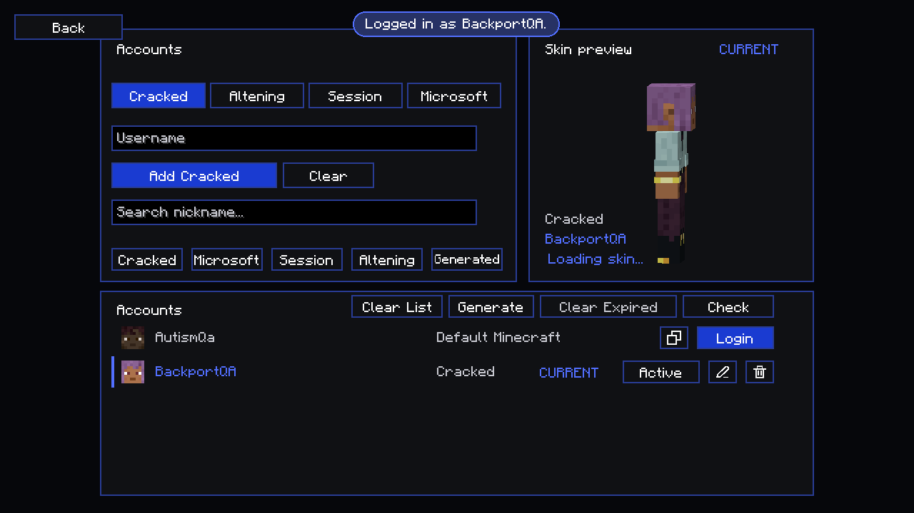

# Minecraft 1.21.11 backport

[Download the installable JAR](autism-account-manager-5.0-backport.3+1.21.11.jar).

Requires Minecraft 1.21.11, Fabric Loader 0.20.1 or newer, Java 21 or newer, and
Fabric API 0.141.6+1.21.11. Install the JAR in the instance's `mods` folder and
open **Multiplayer → Accounts**.

The JAR is the exact artifact tested in a fresh production-mode instance on
Java 21.0.13. Seventeen runtime checks passed; see [validation.json](validation.json).
The runtime test checks encrypted storage using synthetic data. Microsoft OAuth, real session tokens, TheAltening,
multiplayer authentication, other mods, and Linux/macOS remain untested.

The **5.0-backport.3** release applies the same exact indigo palette as the other
four ports: `#06070B` menu, `#101114` panels/idle buttons, `#000000` fields,
`#1A3BD1` primary actions/selected tabs, `#293C94` default outlines, `#526FFF`
focus rings/active usernames, `#8181D9` hover outlines, `#FCFCFC` text, and
`#C8C9D1` placeholders. Hovering changes the outline while the primary fill stays
deep blue. Screenshot color evidence is in [palette-colors.json](palette-colors.json).

Source and build instructions are at the repository root. Original authorship
belongs to Melonik; this is an unofficial account-manager backport.

