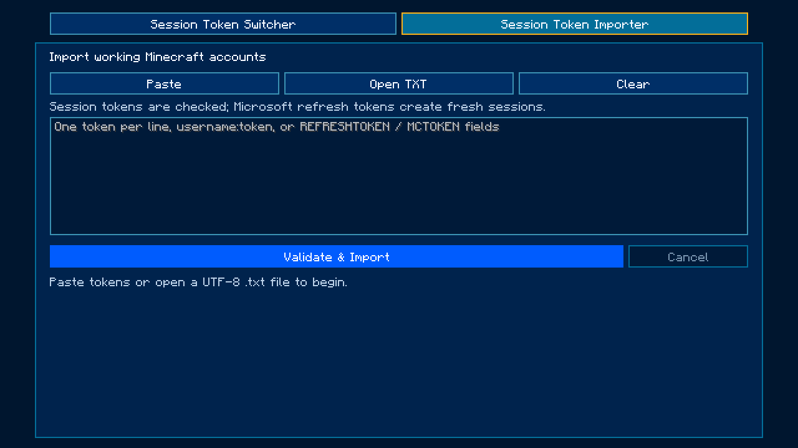
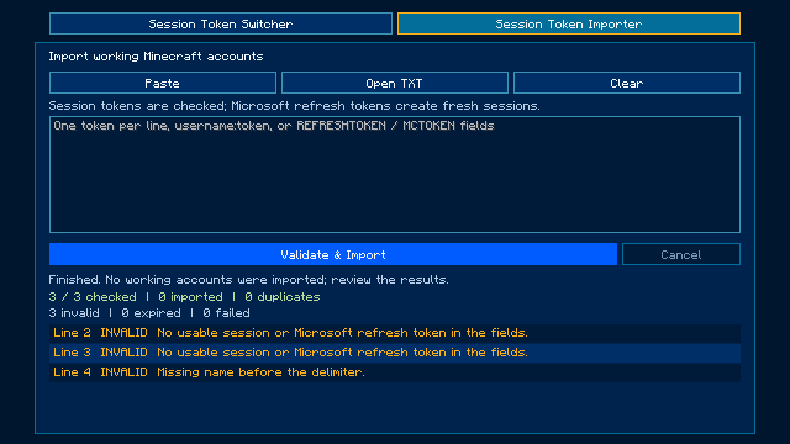

# Minecraft 1.21.11 backport

[Download the installable JAR](autism-account-manager-5.0-backport.3+1.21.11.jar).

Requires Minecraft 1.21.11, Fabric Loader 0.20.1 or newer, Java 21 or newer, and
Fabric API 0.141.6+1.21.11. Install the JAR in the instance's `mods` folder and
open **Multiplayer → Accounts → Session Token Importer**. Paste tokens, open a
UTF-8 TXT, or drop a TXT onto the importer, then click **Validate & Import**.
Validated accounts appear in the adjacent **Session Token Switcher** tab.

The JAR is the exact artifact tested in a fresh production-mode instance on
Java 21.0.13. Forty-seven runtime checks passed; see
[validation-importer.json](validation-importer.json). The build also passed 161
deterministic authentication, import, and encryption checks with synthetic data.
DPAPI interoperability with the original 26.2 build passed in both directions
using synthetic data. Microsoft OAuth, real session tokens, TheAltening,
multiplayer authentication, other mods, and Linux/macOS remain untested.
The native Open TXT dialog is compiled and available; runtime TXT loading was
checked through the drag/drop path. Real Microsoft refresh authentication was
not attempted. The earlier backport.2 JAR and validation.json are retained.

Source and build instructions are at the repository root. Original authorship
belongs to Melonik; this is an unofficial account-manager backport.

